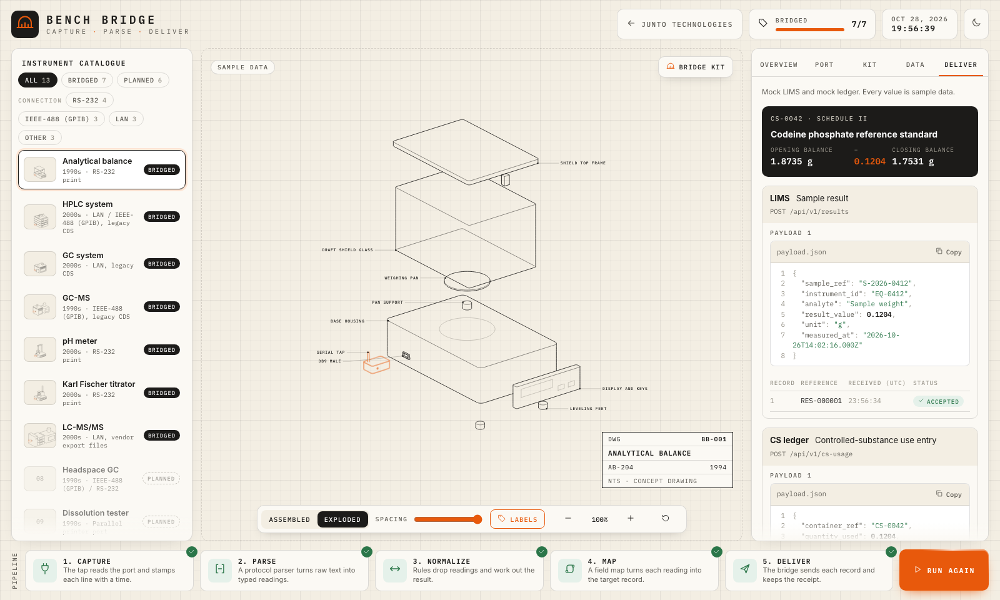
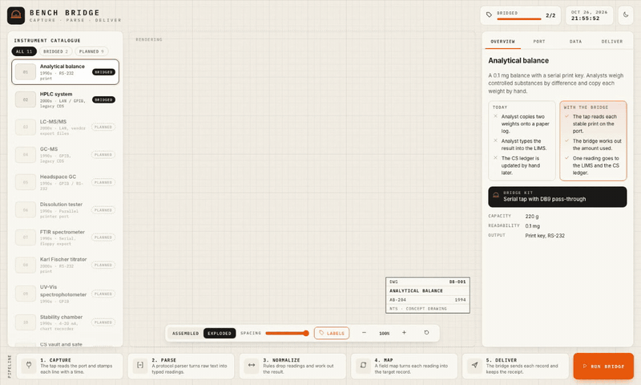

# Bench Bridge

A demo of how older lab instruments feed a LIMS and a controlled-substance (CS) ledger.
One reading becomes a sample result in the LIMS and a use entry in the CS ledger. Both are mock in the demo. All data is sample data.
Live today: <!-- gen:fact catalog.liveNames -->Analytical balance, HPLC system, GC system, GC-MS, pH meter, Karl Fischer titrator, and LC-MS/MS<!-- /gen -->. <!-- gen:fact catalog.planned -->6<!-- /gen --> more instruments are planned.
The demo has no database. The ledger is stateless: every run starts from the same opening balance.

Live demo: <!-- gen:fact site.url -->https://bench-bridge.juntotechnologies.com/<!-- /gen -->
The live demo runs the delivery API in the browser. The ledger resets on each page load.

Make the pictures again with `npm run media`.

## Layout

<!-- gen:dirs -->
| Directory | Holds |
| --------- | ----- |
| `client/` | The browser app: the UI, the drawings and the web worker. |
| `design/` | The design spec: one source for the look of the app. Copy this directory to reuse the look in another project. |
| `docs/` | Documentation for people. |
| `server/` | The delivery API: mock LIMS and CS ledger endpoints, and the dev server. |
| `shared/` | Code and data that both client and server use. It holds no UI, no network and no server code. |
| `site/` | The GitHub Pages build: the client app with its delivery API running inside the browser. |
| `tests/` | All tests live here. The directory mirrors the code areas. |
| `tools/` | Repo tooling that enforces the rules. |
<!-- /gen -->

Every directory has an `AGENTS.md` with its domain knowledge and rules.

## Commands

<!-- gen:scripts -->
| Command | Does |
| ------- | ---- |
| `npm run dev` | Starts the app and the API, and prints the one tailnet link |
| `npm run build` | Typechecks, then builds the client into dist/ |
| `npm run build:pages` | Builds the static site for GitHub Pages, with the delivery API in the browser |
| `npm run typecheck` | Typechecks all areas |
| `npm run lint` | ESLint, the AGENTS.md check and the docs check |
| `npm run test` | Runs all tests in tests/ |
| `npm run proof` | Renders every instrument and kit drawing to proof/ |
| `npm run drawings` | Draws every instrument and kit under Node, and fails when a part or a builder is missing |
| `npm run health` | Checks that the dev server answers |
| `npm run check` | Typecheck, lint, test, check the drawings, build and build the static site |
| `npm run docs` | Rewrites every generated block from its source |
| `npm run media` | Builds the static site, records it, and writes the README screenshot and GIF |
| `npm run fit` | Builds the static site, opens it at nine window sizes, and fails when the page scrolls, a region is clipped, a control is too small to tap, or the layout budget breaks |
| `npm run design` | Writes design/tokens.css, SPEC.md and spec.lock from the JSON sources |
| `npm run seo` | Writes the discovery files, icons and home page tags from site/seo.json |
<!-- /gen -->

## Instruments

<!-- gen:catalog -->
| # | Instrument | Connection | Interface | Era | Status | Why it matters |
| --- | ---------- | ---------- | --------- | --- | ------ | -------------- |
| 1 | Analytical balance | RS-232 | RS-232 print | 1990s | Bridged | Every controlled-substance weigh-out must match the CS ledger. |
| 2 | HPLC system | LAN | LAN / IEEE-488 (GPIB), legacy CDS | 2000s | Bridged | Assay and purity results. CDS and OS updates drop old instrument drivers. |
| 3 | GC system | LAN | LAN, legacy CDS | 2000s | Bridged | Residual solvent and purity results. CDS and OS updates drop old instrument drivers. |
| 4 | GC-MS | IEEE-488 (GPIB) | IEEE-488 (GPIB), legacy CDS | 1990s | Bridged | Identity tests for controlled substances. |
| 5 | pH meter | RS-232 | RS-232 print | 2000s | Bridged | pH results for buffers and solutions are copied from the display. |
| 6 | Karl Fischer titrator | RS-232 | RS-232 print | 2000s | Bridged | Water content results are typed in from a strip printer. |
| 7 | LC-MS/MS | LAN | LAN, vendor export files | 2000s | Bridged | Potency and trace results sit in vendor files the LIMS cannot read. |
| 8 | Headspace GC | IEEE-488 (GPIB) | IEEE-488 (GPIB) / RS-232 | 1990s | Planned | Residual solvent results for release testing. |
| 9 | Dissolution tester | Other | Parallel printer port | 1990s | Planned | Release results print on paper strips. |
| 10 | FTIR spectrometer | RS-232 | RS-232, floppy export | 1990s | Planned | Identity tests on incoming controlled-substance lots. |
| 11 | UV-Vis spectrophotometer | IEEE-488 (GPIB) | IEEE-488 (GPIB) | 1990s | Planned | Assay and identity results need an old PC with a GPIB card. |
| 12 | Stability chamber | Other | 4–20 mA, chart recorder | 1990s | Planned | Storage condition records for stability studies are on paper charts. |
| 13 | CS vault and safe | Other | Door contact, keypad log | 2000s | Planned | Access to controlled-substance storage must be logged. |
<!-- /gen -->

## Notes

- The demo uses sample data. It makes no claim of Part 11 compliance.
- Search engines and agents find the demo through the files that `npm run seo` writes. The copy lives in `site/seo.json`.
- Drawings use the vendored `/teardown` skill (MIT) in `.agents/skills/teardown/`.
- Every figure, count, file list and command table in the docs is generated. Run `npm run docs` after a change.
